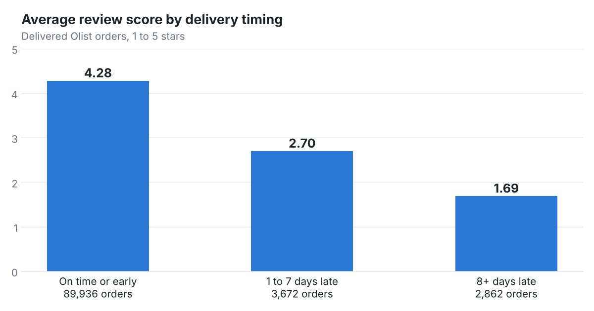
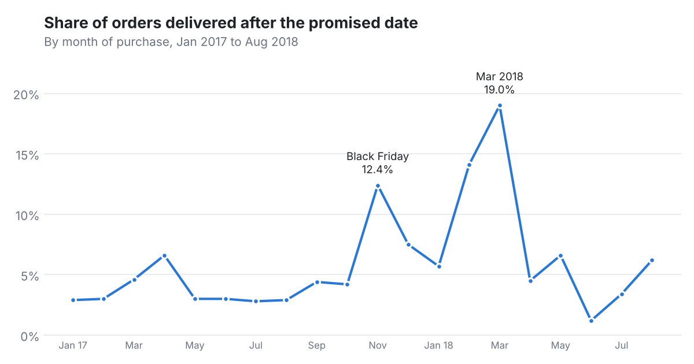

# Olist Retail Analytics (PostgreSQL)

A SQL analysis of Olist, a Brazilian ecommerce marketplace: about 99,000 orders from 2016 to 2018 across eight related tables. It covers revenue, customers, sellers and payments, then digs into the question that matters most for a marketplace: **what happens when a delivery is late?**

## Headline finding

Late deliveries wreck customer reviews. Orders that arrive on time average 4.28 stars. Orders one to seven days late average 2.70, and orders eight or more days late average 1.69, with 79% of those customers leaving one or two stars.



Olist promises delivery in about 24 days on average but delivers in a median of 10, so only 6.8% of orders arrive late overall. The misses cluster in a few months: 12.4% of November 2017 orders (Black Friday) and 19.0% of March 2018 orders arrived late.



## Key metrics (delivered orders)

| Metric | Value |
|---|---|
| Delivered orders | 96,478 |
| Unique customers | 93,358 |
| Product revenue (excludes freight) | $13.22M |
| Average order value | $137.04 |
| Items per order | 1.14 |
| Repeat customer rate | 3.0% |
| Sellers | 2,970 |

## Insights

1. **Almost nobody comes back.** Only 3.0% of customers placed a second delivered order. Growth came from new buyers, which makes first impressions, and on time delivery, critical.
2. **Growth, then a plateau.** Monthly revenue grew from about $112K in January 2017 to a peak of $988K in November 2017, then leveled off between $826K and $978K a month from January to August 2018.
3. **A long tail of categories.** Revenue spans 74 categories. The top five (health and beauty, watches and gifts, bed and bath, sports and leisure, computer accessories) make up 40%, and no single category tops 10%.
4. **A concentrated seller base.** 533 sellers, 18% of the total, generate 80% of revenue.
5. **Credit cards and installments drive spending.** Credit cards account for 78% of payment value and boleto (a Brazilian bank payment slip) for 18%. Card purchases split into 7 or more installments average $335, compared with $96 for single payments.
6. **Geography shapes delivery.** Customers in São Paulo get orders in a median of 7 days. Northern states such as Amazonas, Roraima and Amapá wait 24 to 26 days, and Alagoas has the highest late rate at 21%.

## Data checks

Several details in this dataset mislead anyone who counts the raw tables. I checked each before trusting a number:

| Issue | Effect if ignored | How I handled it |
|---|---|---|
| `customers` has one row per order, not per person | Customer count overstated (99,441 vs 96,096 people) | Counted `customer_unique_id` |
| 2,963 orders are canceled, unavailable or not yet delivered | Revenue includes $370K that was never completed | Revenue and AOV use delivered orders |
| 775 orders have no items | Items per order understated | Averaged over orders with items |
| 2016 and Sept to Oct 2018 have only a handful of orders | Fake spikes and crashes in trend charts | Trends use full months, Jan 2017 to Aug 2018 |
| Payment values include freight | Payment totals don't match product revenue | Kept payment and product revenue separate |
| Category names are in Portuguese | Hard to read results | Joined the official translation table |

## SQL techniques

- Multi-table joins across eight tables with enforced primary and foreign keys
- CTEs to stage each step of an analysis
- Window functions: `LAG` for month over month growth, running totals, `RANK`, cumulative share, and a Pareto cut for seller concentration
- `PERCENTILE_CONT` for median delivery times
- `FILTER` clauses and conditional aggregation for rates

## Repository

| File | Purpose |
|---|---|
| `schema.sql` | Tables, keys and indexes for all eight source files |
| `load.sql` | Loads the CSVs with `\copy` |
| `queries.sql` | Data checks and every analysis query, in README order |
| `images/` | Charts used above |

## How to run

1. Download the [Brazilian E-Commerce Public Dataset by Olist](https://www.kaggle.com/datasets/olistbr/brazilian-ecommerce) from Kaggle. The CSV files are too large for this repository.
2. Create the database and load the data from the folder that holds the CSVs:

```bash
createdb olist_retail
cd path/to/olist_csvs
psql -d olist_retail -f path/to/schema.sql
psql -d olist_retail -f path/to/load.sql
```

3. Run `queries.sql` in psql or pgAdmin's Query Tool, section by section.

Tested on PostgreSQL 16. Review figures come from the 100,000 row reviews file; other releases of the dataset may differ slightly.

## Tools

PostgreSQL, pgAdmin, Python (matplotlib) for the two charts, Git and GitHub.
